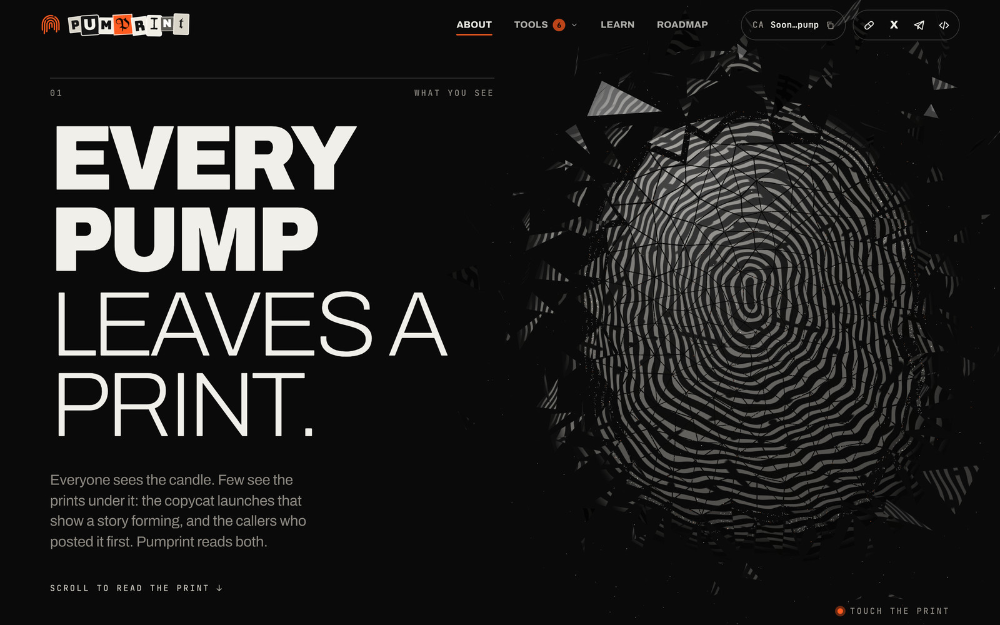
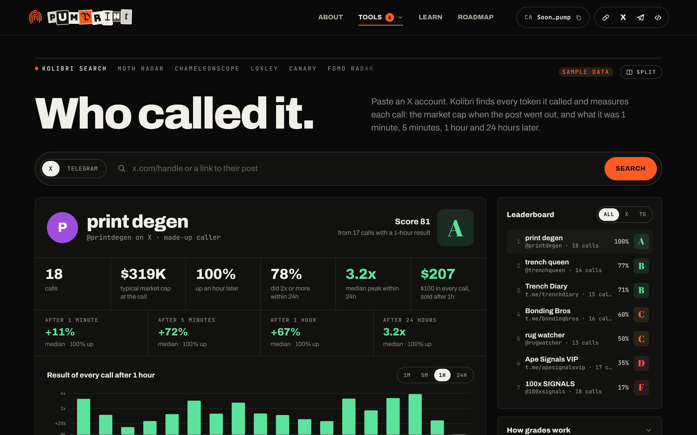
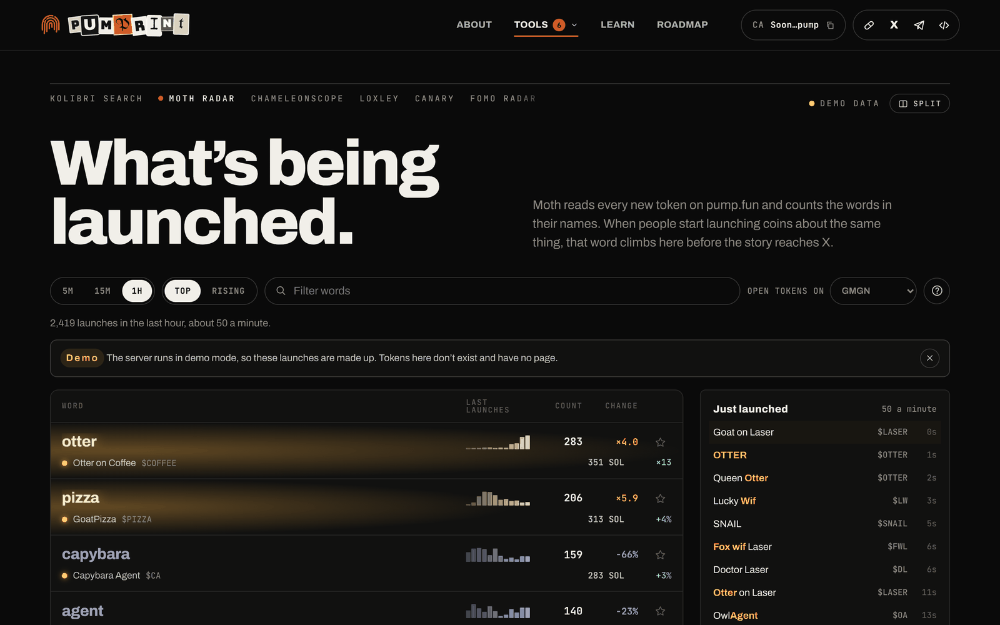
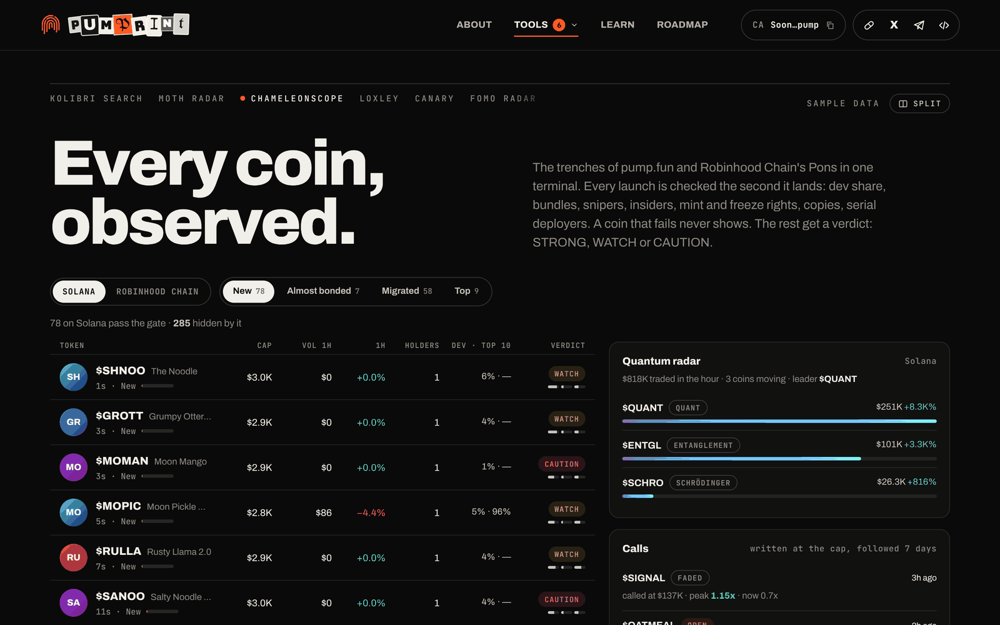
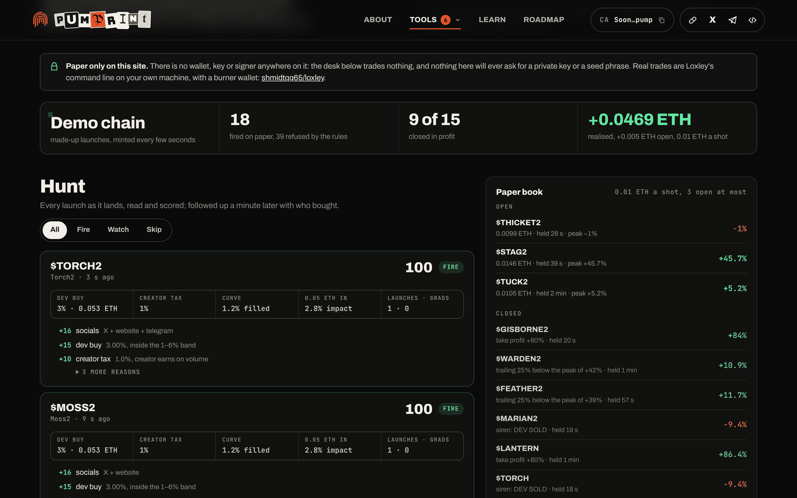
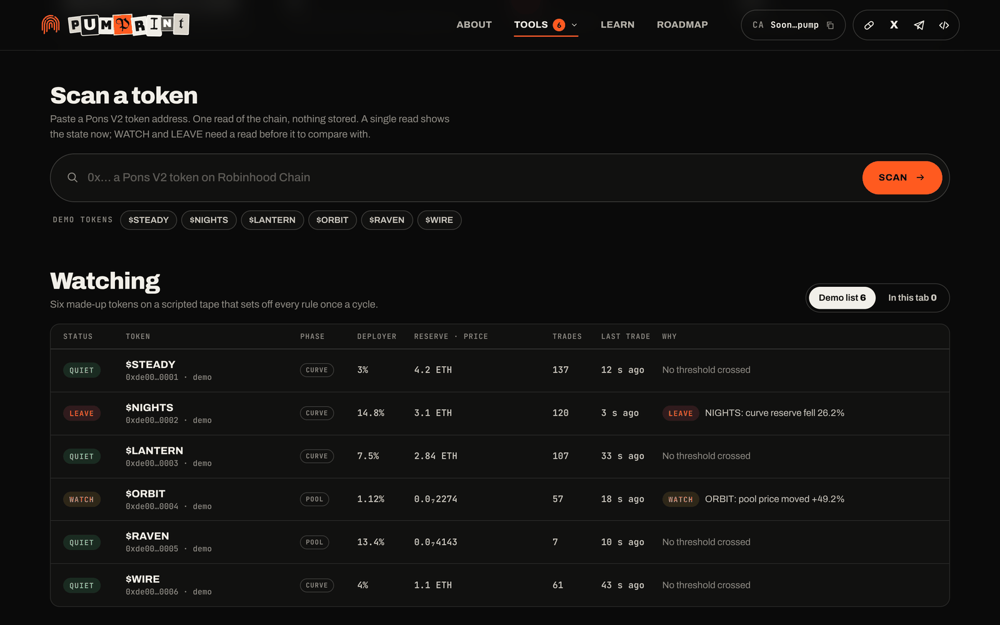
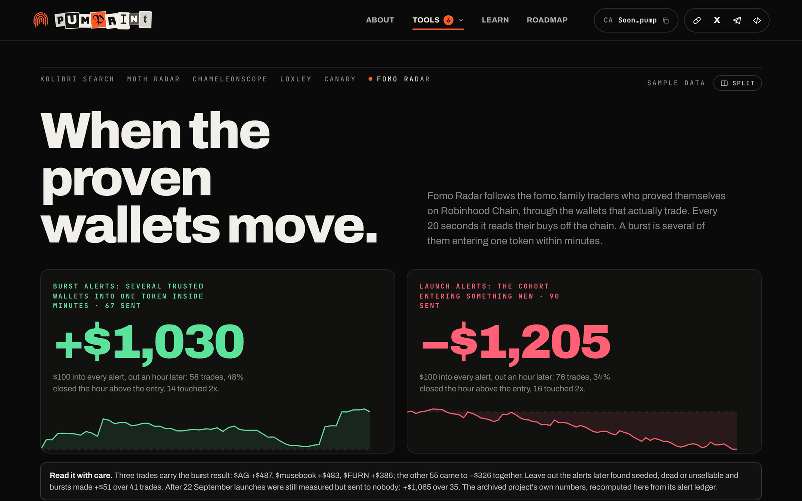
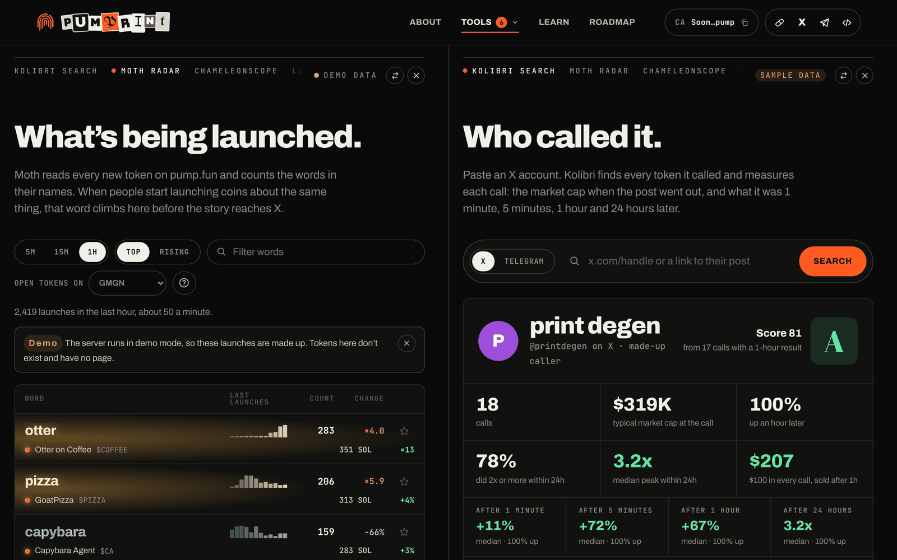
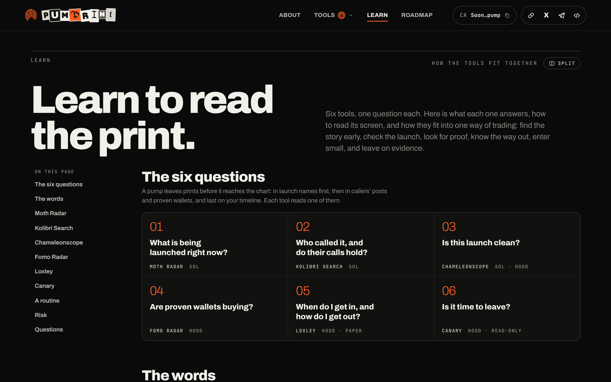
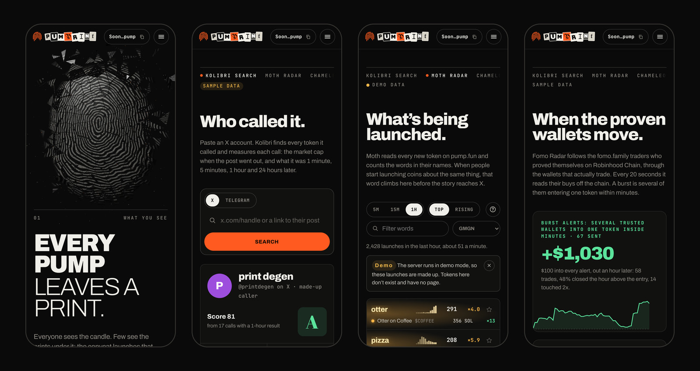

# Pumprint

Six open-source trench tools for pump.fun and Robinhood Chain on one website, under a 3D fingerprint you can shatter.



A black stage, a big headline on the left and a 3D fingerprint on the right. The print is built from triangle shards with the ridges engraved on them: hover it and it flies apart, a cloud of dots glows underneath, and the coins trending on Solana right now fly out.

The header reads **About · Tools ▾ · Learn · Roadmap**. The **Tools** menu opens the six tools, and every tool page has a row of tabs at the top to switch between them in one click. If you'd rather have six flat tabs in the header instead of the menu, edit the `nav` markup in [`public/index.html`](public/index.html).

No tool on the site asks for or stores a private key or a seed phrase, and the site has nothing to sign transactions with.

## The six tools

<table>
<tr>
<td width="50%" valign="top">
<a href="docs/screenshots/kolibri.png"></a>
<p><b>Kolibri Search</b> · Solana · <a href="https://github.com/Ridarketh/kolibri-search-">Ridarketh/kolibri-search-</a><br>
Paste an X account (or one of its posts, or a Telegram channel) and see every token it called: the market cap at the call and 1 minute, 5 minutes, 1 hour and 24 hours later. Grades from A to F and a leaderboard.</p>
</td>
<td width="50%" valign="top">
<a href="docs/screenshots/moth.png"></a>
<p><b>Moth Radar</b> · Solana · <a href="https://github.com/Ridarketh/Moth-radar">Ridarketh/Moth-radar</a><br>
Every new pump.fun launch is split into the words of its name. See which words are picking up speed over 5, 15 and 60 minutes, and which token with that word is trading.</p>
</td>
</tr>
<tr>
<td width="50%" valign="top">
<a href="docs/screenshots/chameleonscope.png"></a>
<p><b>Chameleonscope</b> · Solana · Robinhood Chain · <a href="https://github.com/shmidtqq65/chameleonscope">shmidtqq65/chameleonscope</a><br>
A trench terminal. New, Almost bonded and Migrated feeds for pump.fun and Pons behind a rug filter (dev share, bundles, snipers, insiders, mint and freeze), the terminal's own calls with entry cap and peak, smart wallets and KOL buys via GMGN, and a quantum radar.</p>
</td>
<td width="50%" valign="top">
<a href="docs/screenshots/loxley.png"></a>
<p><b>Loxley</b> · Robinhood Chain · <a href="https://github.com/shmidtqq65/loxley">shmidtqq65/loxley</a><br>
A sniper for Pons V2 launches, <b>paper-only on this site</b>. Every launch gets a score and the reasons behind it; the desk enters once the 99% anti-snipe tax drops under its ceiling, marks positions at the exact price of leaving, and exits by its rules, on a siren, or when the dev moves tokens. Plus a single-token read and the market.</p>
</td>
</tr>
<tr>
<td width="50%" valign="top">
<a href="docs/screenshots/canary.png"></a>
<p><b>Canary</b> · Robinhood Chain · <a href="https://github.com/Gipppp121/canary">Gipppp121/canary</a><br>
A read-only watchdog for Pons V2 positions: dev share, curve reserve, pool liquidity, swaps. Ten rules give QUIET, WATCH or LEAVE. A server watchlist with Telegram alerts, and an "in this tab" list for any visitor.</p>
</td>
<td width="50%" valign="top">
<a href="docs/screenshots/fomo.png"></a>
<p><b>Fomo Radar</b> · Robinhood Chain · <a href="https://github.com/cvxv666/fomo-robinhood-radar">cvxv666/fomo-robinhood-radar</a><br>
Strong fomo.family traders on Robinhood Chain, followed through their real wallets, with an alert when several of them enter one token within minutes. The project was archived on 6 October 2026; the page shows its archive of results and a live radar carried over to this site.</p>
</td>
</tr>
</table>

**About** is the home page: the 3D fingerprint, a ticker of trending coins, the six tools, the method and the data sources. **Roadmap** is empty for now. The screenshots come from demo mode (`npm run demo`), so the tokens, callers and wallets in them are made up.

## Two tools on one screen



On the right of the row above every tool, next to the data badge, there's a **Split** button. It lists the other tools (and Learn), and the one you pick opens alongside. The address of such a screen is `#moth+kolibri` (left side + right side), so you can bookmark it.

Each side has its own scroll and its own row of tabs (which switches only that side), plus ⇄ to swap the sides and × to close one. Drag the divider with the mouse or the arrow keys; a double-click splits the screen in half, and the width is remembered. Token cards open inside their own side. Split view needs a screen at least 1100 pixels wide; on a narrower one you get the left side.

Pages fit the width of their side by themselves: on the first split, the site repeats its `@media (max-width: …)` rules as container queries for each side ([`buildPaneQueries` in app.js](public/assets/js/app.js)).

## Learn



**Learn** is the handbook: the six questions the tools answer, a glossary (bonding curve, migration, dev share, bundles, opening tax…), and for each tool what it shows, how to read the screen, how to use it and where to be careful; then a routine for a session, the risks and an FAQ. The "Open it beside this guide" button opens a tool next to the guide, and the guide scrolls to that tool's section.

## On a phone



Every page works on a phone; the header folds into a menu.

## Run it on your computer

You need Node.js 22.13 or newer. No `npm install`: everything the site needs is already in the folder.

```bash
npm run demo     # everything on made-up data, works offline
npm start        # live data: pump.fun, Solana, Robinhood Chain, Telegram, prices
```

Open http://localhost:8080.

In demo mode each tool gets its own made-up world: Chameleonscope shows sample launches, Loxley trades on paper on the loxley mock chain (a launch every few seconds), Canary watches six made-up tokens on a scripted tape that sets off all ten rules, and Fomo Radar replays a made-up day.

## Name, contract address and links

All in one file, [`public/config.js`](public/config.js):

```js
name: 'PUMPRINT',          // cut-out letters in the header and footer
contractAddress: '',       // empty for now: the header shows "Soon…pump"
links: { pump: '', x: '', telegram: '', github: '' },  // social buttons
```

While a link is empty, its button shows "Link coming soon" when clicked. The exception is Telegram: without a link, the button opens the site's `#telegram` page, "Coming soon" over a big, dark, blurred fingerprint.

## Deploy

The site is one Node process: it serves the pages and keeps one connection to pump.fun for Moth and Chameleonscope, one request queue to Robinhood Chain for every tool on that chain, and the SQLite databases. Any host that keeps the process running will do: a VPS, Railway, Render (a paid instance), Fly.io. Hosts that put apps to sleep lose the live streams while asleep. Give it 1 GB of memory or more: the Chameleonscope terminal runs in its own thread and restarts itself above `CHAMELEON_MEMORY_MB`.

**Docker:**

```bash
docker build -t pumprint .
docker run -d --restart unless-stopped -p 8080:8080 -v pumprint-data:/app/data --env-file .env pumprint
```

**Railway / Render:** connect the repository; the start command is `npm start` and the port comes from `PORT`. Add a persistent disk at `/app/data` (or set `DATA_DIR`) so the databases and history survive restarts.

Put the site behind HTTPS (PaaS hosts do this by default); Moth then runs over `wss://`.

## Robinhood Chain tools

Chameleonscope, Loxley, Canary and Fomo Radar read Robinhood Chain (chain id 4663) through **one shared queue** ([`server/hood/rpc.js`](server/hood/rpc.js)). The public node limits the request rate, so the tools share one budget instead of competing for it. The queue spaces requests out, waits out 429 responses, tries the backup addresses in `HOOD_RPC_SPARES`, and halves log ranges that are too large. The public node needs no key.

### Loxley: paper only

On this site Loxley runs **in paper mode only, and only reads**:

- the site loads loxley's read, scoring and paper-sniper modules, but never `cli/wallet.js` or `cli/trade.js`: their place in the module cache is taken by stand-ins that throw on any use ([`server/loxley/safe.js`](server/loxley/safe.js));
- instead of viem, loxley gets a cut-down set (the ABI codec and units) with no wallet client, accounts or seed phrases;
- loxley's environment is built only from its defaults and the allowed `LOXLEY_*` variables: `PRIVATE_KEY`, `MNEMONIC` and the keystore password are always empty, and loxley's own `.env` file is never read;
- every request to the node goes through a bridge that lets only read methods through;
- the API has GET routes only; `/api/loxley/health` shows that the stand-ins are in place.

Real trades are loxley's command line on your own computer, with a separate wallet: `git clone https://github.com/shmidtqq65/loxley && cd loxley && node bin/loxley.js tour`.

**Pace.** Loxley is built for one person with their own RPC: it polls every half second. Here, sharing the public node with the other tools, it runs slower: new launches every 2 seconds, one follow-up check a minute later, position marks every 15 seconds, at most two positions open. `LOXLEY_RPC_URL` (your own provider: Alchemy, QuickNode) gives it the command line's pace on that address. `LOXLEY_EXPLORER_API_KEY` (a free Blockscout key) turns on the deployer X-ray. The paper sniper's rules are loxley's own variables with a `LOXLEY_` prefix (`LOXLEY_MIN_SCORE`, `LOXLEY_TAX_CEILING_BPS`, `LOXLEY_TAKE_PROFIT_PCT`…); `LOXLEY_FOLLOW` lists wallets whose buys the paper desk copies.

### Canary

- **The server's watchlist**: tokens from `CANARY_TOKENS` and wallet positions from `CANARY_WALLETS` (Canary finds those among recent launches). The server compares every sweep with the previous one, keeps the history on disk and sends alerts to Telegram (`CANARY_TELEGRAM_TOKEN`, `CANARY_TELEGRAM_CHAT_ID`).
- **Only the site owner can change that list from the page**: with the `CANARY_CONTROL_TOKEN` key (typed into the "Operator" field and kept until the tab closes), or without a key when the site listens only on `127.0.0.1` (`HOST=127.0.0.1`), that is, when it runs on your own computer. This is Canary's own rule.
- **In this tab**: any visitor can keep up to five tokens of their own. The page reads them once a minute through the server and runs the same ten Canary rules right in the browser (built from Canary's source), comparing each read with the last one. The list lives only in the browser.
- A one-off scan of any token is rate-limited (12 a minute per address, 60 across everyone) and cached for 15 seconds.
- If the server's environment holds `PRIVATE_KEY`, `SECRET_KEY`, `MNEMONIC`, `SEED_PHRASE` or `WALLET_PRIVATE_KEY`, Canary refuses to run, just like the original.

### Fomo Radar

The project was archived on 6 October 2026: its site and bot are off, and the code and the archive of results remain. The page shows:

- **the archive**: by the author's count, $100 into every burst alert would have made **+$1,030 over 67 alerts**, and the same $100 into every new-launch alert **−$1,205 over 90 alerts** (measured an hour later). The numbers are recomputed here from the project's alert log and match its `summary.json`. Under them are the caveats: three trades make almost all of the burst result, and what's left without the "seeded", dead and unsellable tokens;
- **the live radar**: the same wallet list is read from the node every 20 seconds; a burst is a sum of (score/100)² ≥ 4 from three or more trusted wallets within 30 minutes, with the same checks before an alert. No key needed. Telegram alerts: `FOMO_TELEGRAM_BOT_TOKEN`, `FOMO_TELEGRAM_CHAT_ID`.

Wallet addresses, score texts and traders' PnL are not shown on the page. The repository of the same name under bl888m is only a fork.

### Chameleonscope

The terminal's engine runs unchanged in its own server thread. It takes the pump.fun launch stream from the same connection as Moth, and its Solana RPC requests go no faster than `CHAMELEON_RPC_RPS` per second. Smart wallets and KOL buys need `GMGN_API_KEY`; without it that panel says plainly that it's off, and everything else works.

## Kolibri and X

Works right away, without keys:

- a link to **one post** on X (`x.com/name/status/…`): the post is read through X's public oEmbed;
- **Telegram channels** (public ones, with a preview at `t.me/s/…`).

To look up **whole X accounts**, the server needs one key for X data. There's no free way to read an X timeline:

| Key | Price | One first lookup |
| --- | --- | --- |
| `TWITTERAPI_IO_KEY`: [twitterapi.io](https://twitterapi.io), recommended | about $0.15 per 1,000 tweets | up to ~100 tweets ≈ $0.015 |
| `X_BEARER_TOKEN`: the official X API, pay-per-use | $0.005 per post read | up to 200 posts ≈ up to $1 |

Looking up the same account again within 10 minutes is free; after that only new posts are read. `X_LOOKUPS_PER_DAY` (500 by default) caps account reads per day across all visitors.

Market caps come from GeckoTerminal's one-minute candles. Free, that's about 10 requests a minute, so a caller's long history takes a few minutes to fill in; a free `COINGECKO_DEMO_KEY` makes it about three times faster.

## Settings

Copy [`.env.example`](.env.example) to `.env`: every variable is described there. The most useful ones:

| Variable | What for |
| --- | --- |
| `TWITTERAPI_IO_KEY` or `X_BEARER_TOKEN` | X data, to look up whole X accounts in Kolibri. |
| `TRACK_X`, `TRACK` | X accounts and Telegram channels Kolibri reads around the clock (the leaderboard). |
| `COINGECKO_DEMO_KEY` | Candles for Kolibri's market caps arrive several times faster. |
| `SOLANA_RPC_URL` | Your own Solana RPC (Helius, QuickNode), steadier than the public one for Moth and Chameleonscope. |
| `GMGN_API_KEY` | Smart wallets and KOL buys in Chameleonscope. |
| `HOOD_RPC_URL`, `HOOD_RPC_SPARES` | Robinhood Chain for every tool on that chain. The public node by default. |
| `LOXLEY_RPC_URL` | Your own RPC for Loxley only: the command line's pace. |
| `CANARY_TOKENS`, `CANARY_WALLETS`, `CANARY_TELEGRAM_*`, `CANARY_CONTROL_TOKEN` | Canary's server watchlist, alerts and owner key. |
| `FOMO_TELEGRAM_BOT_TOKEN`, `FOMO_TELEGRAM_CHAT_ID`, `SITE_URL` | Fomo Radar alerts in Telegram. |
| `CHAMELEON=0`, `LOXLEY=0`, `CANARY=0`, `FOMO=0` | Turn a tool off on the server. |
| `HOLDER_MINT`, `HOLDER_SYMBOL`, `FREE_WINDOWS`, `ACCESS_SECRET` | Access to Moth's 5m and 15m windows for holders of your token. |
| `KOLIBRI_NETWORK=1` | Kolibri's original network server at `/kolibri`, for the extension's network mode. |

## How it's built

```
server/index.js            one server: the site and the six tools
server/hood/rpc.js         the shared request queue to Robinhood Chain
server/pumptee.js          one PumpPortal connection for Moth and Chameleonscope
server/moth.js             Moth under /moth (REST and the /moth/ws WebSocket)
server/kolibri.js, kol/    Kolibri: /api/kolibri, optionally the original server at /kolibri
server/chameleon/          the Chameleonscope engine in its own thread: /api/chameleon
server/loxley/             Loxley on paper: key stand-ins (safe.js), the paper desk, reads, demo world: /api/loxley
server/canary/             Canary: the engine (engine.mjs, built from source), the RPC guard (viem-shim.mjs), /api/canary
server/fomo/               Fomo Radar: wallet reads, burst rules, the one-hour measure, demo: /api/fomo
vendor/                    the tools' own code: kolibri, moth, chameleonscope, loxley, canary, fomo
vendor/viem                viem 2.56.3 in one file (from loxley), shared by Loxley and Canary
public/                    the site itself: index.html, assets/css, assets/js/<tool>/page.js, assets/js/learn/page.js
scripts/                   builds Canary's engine and the sample data for serverless mode
docs/screenshots/          the pictures in this README
```

The tools' code is used as published. The one edit: a line in `vendor/loxley/vendor/viem.js` points to the shared `vendor/viem/viem.cjs` (byte for byte the same file). The short `package.json` files in `vendor/kolibri`, `vendor/moth` and `vendor/chameleonscope` only tell Node how to load that code, and `vendor/fomo` holds Fomo Radar's archive, fixtures and cases (its Python radar is ported to Node in `server/fomo/`). Canary is built from `vendor/canary/src` with `npm run build:canary` (needs esbuild: `npm i --no-save esbuild`); `npm run test:canary` runs Canary's own 46 tests against the same build.

## Without a server

The `public/` folder can go on a static host (Netlify, Vercel, Cloudflare Pages, GitHub Pages). Paths in the page are relative, so the site also works from a subfolder such as `your-name.github.io/pumprint/`. Without a server:

- Moth reads pump.fun straight from the visitor's browser; Kolibri shows sample callers;
- Chameleonscope, Loxley, Canary and Fomo Radar show recorded samples marked Sample / Recorded, since only a server can read the chains. Fomo Radar's archive is shown in full: it's built into the page.

## The fingerprint

The header logo is the `#i-print` symbol in [`public/index.html`](public/index.html): ridge arches around a loop in the middle, with breaks and ends of different lengths, like a real print. The browser tab uses [`public/favicon.svg`](public/favicon.svg), the same drawing without the outer arc and with heavier lines so it reads at 16 pixels. The Telegram page background is [`public/assets/js/soon.js`](public/assets/js/soon.js), and the big 3D fingerprint is [`public/assets/js/print3d.js`](public/assets/js/print3d.js).

## Tests

```bash
npm test     # the site in demo mode: every endpoint of the six tools, Canary's rules on a mock chain,
             # Loxley's key and signing lockout, Fomo's parsers on real node responses
```

## Licenses

All six tools are MIT: see `vendor/*/LICENSE`. viem and the packages inside `vendor/viem/viem.cjs` are MIT, with notices in `vendor/viem/LICENSES.md`. three.js is MIT (`public/assets/vendor/three.LICENSE.txt`). Moth and Chameleonscope read launches through PumpPortal, an unofficial pump.fun API. The Robinhood Chain tools are not affiliated with Robinhood, Pons, Uniswap or fomo.family.

The site shows what's being launched, who called it and what wallets are doing, not what to buy. Most new tokens go to zero.
