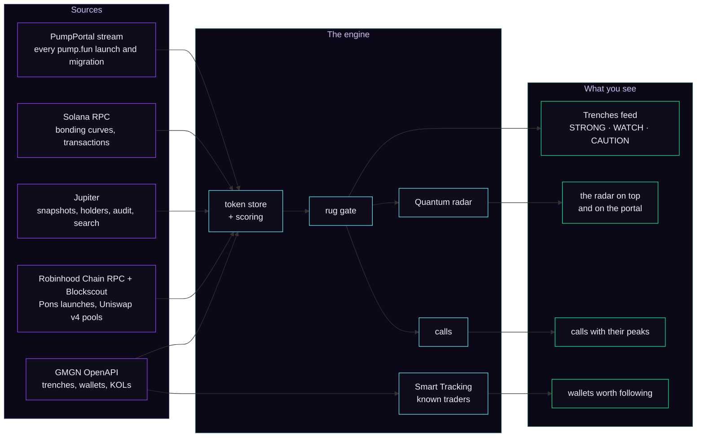
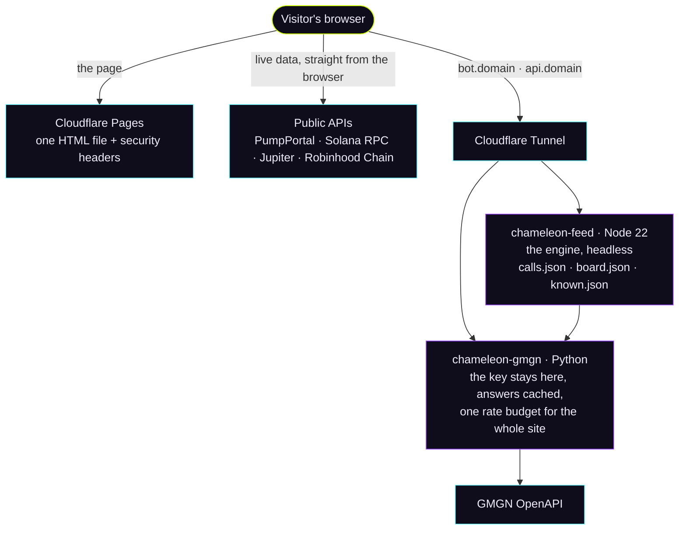

<div align="center">

<a href="https://chameleonscope.com"></a>

### Every coin in the trenches is in superposition until you observe it.

<a href="https://chameleonscope.com"></a>
<a href="CHANGELOG.md"></a>


<a href="LICENSE"></a>
<a href="https://x.com/ChameleonScopee"></a>

**[Live site](https://chameleonscope.com)** &nbsp;·&nbsp; **[Quick start](#0-quick-start)** &nbsp;·&nbsp; **[The Quantum radar](#quantum-radar)** &nbsp;·&nbsp; **[Architecture](docs/ARCHITECTURE.md)** &nbsp;·&nbsp; **[Deploy your own](docs/DEPLOY.md)**

</div>

<br>

<p align="center">
  
  <br>
  <sub><b>The observation.</b> The portal keeps the terminal in superposition: two ghost states of it, one per chain. The eyes are qubits, Bloch spheres inside a chameleon's turret of scales, and they follow you. Connect Phantom and the state collapses into the terminal.</sub>
</p>

<br>

## ⟨ψ| What it is

A chameleon moves each eye on its own. In **|CHAMELEON⟩** each eye is a qubit: one watches **Solana**, the other **Robinhood Chain**.

It is a memecoin terminal for the trenches. Every pump.fun and Pons launch is measured the second it happens, the rugs collapse out before you see them, the calls are written down at the cap they were made at, the smart money has a name and a record, and a live radar follows the hottest narrative in the trenches right now: **quantum**.

The whole terminal is **one self-contained HTML file**, about 1.1 MB, built from plain JavaScript, CSS and HTML by a short Python script. No framework, no bundler, no account server. Open the file and it runs live from public APIs, straight from your browser.

> [!IMPORTANT]
> Analytics only. |CHAMELEON⟩ never trades, never holds funds and never asks for a private key. Sign-in is a Phantom connect that shares a public address and nothing else: no message to sign, no transaction, no fee.

<table>
<tr>
<td width="50%" valign="top">

**⚛️ &nbsp;Quantum radar**<br>
Every quantum, quant, qubit, Q-Day and post-quantum coin on Solana the moment it moves, hottest first, behind the same rug gate as the feed. Blurred on the portal, in numbers once you are in.

</td>
<td width="50%" valign="top">

**🦎 &nbsp;Trenches**<br>
New, Almost bonded, Migrated and Top for both chains, live from the chains themselves. Windows from 5 minutes to 24 hours, GMGN-style filters, every row with its picture and a verdict: STRONG, WATCH or CAUTION.

</td>
</tr>
<tr>
<td valign="top">

**🛡️ &nbsp;Rug gate**<br>
Dev share, bundles, snipers, insiders, honeypots, wash trading, mint and freeze rights, copies, serial deployers. A token that fails collapses out and never shows.

</td>
<td valign="top">

**🎯 &nbsp;Calls**<br>
Bond and breakout calls, at most four an hour, written at the cap of the moment and followed to the end in public: the peak, every mark from 2x to 100x, and the rug if it comes.

</td>
</tr>
<tr>
<td valign="top">

**🧠 &nbsp;Smart Tracking**<br>
The wallets worth following, ranked by strength: GMGN's track-record formula plus the money a wallet puts to work and how recent its record is. A profile for every wallet; paste a contract and see who made money in it.

</td>
<td valign="top">

**⭐ &nbsp;Known traders**<br>
The KOLs and proven wallets by name, and their buys as they happen. Cards only if you turn them on, with your own threshold.

</td>
</tr>
<tr>
<td valign="top">

**📈 &nbsp;BTC Machine · Course · Poly Smart**<br>
A partner's Polymarket BTC 15 and 5 minute signal terminal, its fifteen-lesson course and its smart-trader scanner, embedded as tabs in the same violet night.

</td>
<td valign="top">

**🌾 &nbsp;Chameleon Valley**<br>
A multiplayer farm for the community: one wallet, one chameleon, a hundred homes. Past a hundred players online, newcomers walk the valley as guests.

</td>
</tr>
</table>

<br>

## 🔭 Screens

<p align="center"></p>
<p align="center"><sub><b>The portal.</b> Before anyone signs in, the radar already runs: the hottest quantum coins on Solana, their pictures doubled and blurred, their numbers hidden. In superposition until you observe them.</sub></p>

<br>

<p align="center"></p>
<p align="center"><sub><b>The Quantum radar</b>, the first block of the terminal: the narrative's last hour in four tiles, then its coins, hottest first. Shown here with preview coins.</sub></p>

<br>

<picture>
  <source media="(prefers-color-scheme: light)" srcset="docs/assets/trenches-light.jpg">
  
</picture>
<p align="center"><sub><b>The trenches</b>, in the theme your GitHub uses (switch it and the picture follows). Today's launches, calls at their cap and peak, runners from launch, and every fresh launch with its rug checks. Preview data.</sub></p>

<br>

<table>
<tr>
<td width="50%"></td>
<td width="50%"></td>
</tr>
<tr>
<td align="center"><sub><b>A token page.</b> Every number, every window, and the verdict with the reasons behind it.</sub></td>
<td align="center"><sub><b>Smart Tracking.</b> Wallets ranked by a track record, not by one lucky trade.</sub></td>
</tr>
<tr>
<td></td>
<td></td>
</tr>
<tr>
<td align="center"><sub><b>Migrated.</b> Bonded in the last day and trading in a pool.</sub></td>
<td align="center"><sub><b>The Roadmap.</b> No dates and no token promises: steps, in order. The tree is generated (tools/roadmap_tree.py).</sub></td>
</tr>
<tr>
<td></td>
<td></td>
</tr>
<tr>
<td align="center"><sub><b>BTC Machine</b>, a partner's terminal inside the site.</sub></td>
<td align="center"><sub><b>Chameleon Valley</b> under the quantum dusk.</sub></td>
</tr>
</table>

<p align="center"></p>
<p align="center"><sub>Built for the phone as much as for the desk.</sub></p>

<br>

## <a id="quantum-radar"></a>⚛️ The Quantum radar

Quantum became one of the hottest narratives in the memecoin trenches, so the radar is the first thing the terminal shows. It answers one question: which coins ride the narrative right now, and where is the money going.

1. **The words.** A coin is on the narrative when its name or ticker speaks of it: *post-quantum, quantum, quant, qubit, Q-Day, superposition, entanglement, Schrödinger, Shor, Willow, Bloch, Planck, decoherence, wavefunction, Majorana* and the makers of quantum machines. "Quant" counts as a word of its own (QUANT, QuantAI, Quant Cat); Quantico and quantity do not.
2. **Two ways in.** Every coin the terminal already watches, and a Jupiter search for the narrative's words every few minutes, which finds the ones the feeds have not met yet.
3. **The same gate.** Every coin passes the feed's rug checks and shows with its picture or not at all.
4. **The heat.** Hottest first by the money through it, with the last five minutes counted four times, so a coin heating up right now goes to the front:

```text
heat = volume(1 h) + 4 × volume(5 min)
```

5. **The index.** Above the cards, the narrative's last hour: the money traded through it, its move weighted by volume, how many coins are moving, and the leader.
6. **Before you sign in.** The portal asks Jupiter for the first three words itself, from the visitor's browser, and shows what it finds in superposition: pictures blurred, numbers hidden as `$??.?K`. Connect Phantom and the same coins open in numbers.

<br>

## |0⟩ Quick start

```bash
git clone https://github.com/shmidtqq65/chameleonscope
cd chameleonscope
python3 build.py                       # src/ → dist/trenchlight_feed.html, one file
open dist/trenchlight_feed.html        # macOS (Linux: xdg-open, Windows: start)
```

Opened as a file, the terminal runs **live**, right in your browser: no install, no key, no sign-in. The coins come straight from the chains; the calls, the wallet ranking and the known traders come from the live site's public journal (set `SITE.domain` to `''` in `src/app_core.js` and the page makes its own). Three switches in the address bar change how it starts:

| Add to the address | What you get |
| --- | --- |
| *(nothing)* | Live Solana and Robinhood Chain trenches, straight from the chains |
| `?mode=demo` | The preview flow: invented launches, calls and runners that behave like the trenches, without asking a single data source |
| `?gate=phantom` | The portal and the Phantom sign-in, the way the live site opens |

> [!TIP]
> Have a GMGN API key? Paste it in **Data sources** inside the terminal and GMGN's trenches, Smart Tracking and the known traders switch on. It stays in your browser. On a live site the key lives on your server instead, behind [the proxy](docs/DEPLOY.md#2-the-server-side-optional).

Needs Python 3.8 or newer. Node 22 is optional: the build uses it to check the bundle parses, and [terser](https://github.com/terser/terser), when present, to ship the page without code comments.

<br>

## 🕸️ Entanglement: how it fits together

The same engine runs in two places: in every visitor's browser, and headless on the server, where it keeps the shared call journal, the wallet ranking and the registry of known traders. Nothing is re-implemented on the server: [`server/feed/engine.js`](server/feed/engine.js) loads the very files in `src/` that the page runs.



And how a visitor of the live site reaches it all:



More in [docs/ARCHITECTURE.md](docs/ARCHITECTURE.md): the build, the three ways the page starts, the picture pipeline, the gate, the calls, the scoring and the portal.

<br>

## 📏 Measurements: performance

Version 2.24 went through the terminal frame by frame and took out what made it heavy, without changing how it looks. Frames per second, measured in headless Chromium with no GPU at a Retina pixel ratio (a real Mac is faster; the ratio holds):

| | v2.23 | v2.24 |
| --- | ---: | ---: |
| The portal | 3 | **19** |
| The moment of entry | 3 | **25** |
| The Trenches feed | 12 | **58** |
| Scrolling the feed | 14 | **56** |

<details>
<summary><b>What changed</b></summary>

<br>

- **Glass without the blur.** Every row and panel used to blur what lay behind it, over a background that kept drifting, so every blur was redone on every frame. The glass is now the same translucent fill with no backdrop filter, and the colour fields under the page hold still.
- **Soft by gradient, not by filter.** The portal's fog was three huge layers under a 70 px blur; the ghost terminals were blurred and blended; the eyes and the name glowed through drop shadows recomputed every frame. Now the softness comes from the gradients themselves and the glows are soft lights behind the shapes.
- **Animations the compositor can run alone.** The logo's orbiting electron is two nested rotations; the live dots ping with scale and opacity; the shimmer on a waiting picture slides instead of being repainted.
- **Nothing drawn unseen.** While the portal covers the page, the terminal under it is neither painted nor animated.

</details>

<br>

## 🔒 Decoherence-proof: privacy and safety

- **A public address, nothing else.** Sign-in is a Phantom connect. No message to sign, no transaction, no fee, no account server: the address is the identity in your browser, and your watchlist, filters and journal stay in your browser.
- **Keys stay where they belong.** On the live site the GMGN key lives on the server, behind a proxy that answers browsers from the site's own origin. A private key pasted where an API key goes is refused and never stored.
- **The page cannot be pointed elsewhere.** On its own domain, address parameters that name a data server (`?api=`, `?calls=`, `?gmgn=` and the rest) are ignored.
- **Locked-down headers.** The site cannot be framed by other sites, plugins are off, no `<base>` tricks, no content sniffing, a short referrer ([`cloudflare/_headers`](cloudflare/_headers)).
- **A clean page.** The shipped HTML carries no code comments; the notes live here, in `src/`.

Found something? See [SECURITY.md](SECURITY.md).

<br>

## 🗺️ The repository

```text
src/                     the terminal: plain JS, CSS and HTML, stitched into one page by build.py
  app_core.js              config, the token model, scoring, the store
  app_sources.js           live data straight from the chains (PumpPortal, Solana RPC, Jupiter, Robinhood Chain)
  app_gmgn.js              the GMGN OpenAPI client (your key, or the site's proxy)
  app_quantum.js           the quantum narrative: the words, the heat, the index, the portal's radar
  app_calls.js             calls: bond and breakout, followed to the end
  app_smart.js             Smart Tracking on GMGN data
  app_xray.js              a token's wallets, read from its own transactions
  app_known.js             known traders and their buys
  app_ui.js                the interface
  app_portal.js            the portal: the qubit eyes, the ring, the collapse
  app_gate.js              the Phantom gate
  app_account.js           who is looking: a public address
  app_bottab.js            the Trading bot guide tab
  demo_*.js                the preview flow and its snapshot data
  *.css · *.html           the skin, the portal, the quantum layer, the public pages
server/
  install.sh               one command on a fresh Ubuntu server
  feed/                    the data service: the engine, headless, in Node
  gmgn_proxy.py            the GMGN proxy: the key on the server, a cache, one rate budget
cloudflare/_headers      security headers for Cloudflare Pages
mock/                    stand-in servers for every source, and the Playwright suites
tools/roadmap_tree.py    draws the glowing tree on the Roadmap
backtest/analyze.js      the backtest behind the call rules
docs/                    architecture, the deploy guide, the pictures
build.py · test_all.sh   build the page · run every check
```

<br>

## 🧪 Tests

Every check runs against stand-in servers that play pump.fun, Jupiter, the Solana and Robinhood Chain nodes, Blockscout, DEX Screener and GMGN: nothing real is ever called.

```bash
pip install playwright && python3 -m playwright install chromium   # and Node 22
bash test_all.sh          # every suite, about 10 minutes
bash test_all.sh quick    # the site, the live domain and the GMGN proxy
```

| Suite | What it proves |
| --- | --- |
| `site` | the whole terminal in headless Chromium: feeds, filters, rug gate, token pages, calls, Smart Tracking, the radar, the portal and the gate |
| `live` | the page as served from its own domain: the proxy found, the setup hidden, foreign data servers ignored |
| `proxy` | the GMGN proxy answers one origin and keeps the key |
| `feed` | the data service: calls, ranking, known traders, cached answers, a restart |
| `gmgn` | the GMGN client and the proxy end to end |

<br>

## 🚀 Deploy your own

The page is a static file: build it, put it on Cloudflare Pages (or any static host) with [`cloudflare/_headers`](cloudflare/_headers), and it runs. The server side is optional and takes one command on a fresh Ubuntu machine:

```bash
sudo bash server/install.sh
```

Step by step, with the Cloudflare Tunnel and the domain: [docs/DEPLOY.md](docs/DEPLOY.md).

<br>

## 📜 Changelog

From a prototype on 15 September 2026 to the quantum relaunch: [CHANGELOG.md](CHANGELOG.md).

<br>

## 🙏 Credits

- **Data:** [PumpPortal](https://pumpportal.fun), [pump.fun](https://pump.fun), [Jupiter](https://jup.ag), public Solana RPC nodes, Robinhood Chain's public nodes and [Blockscout](https://www.blockscout.com), [Pons](https://www.ponsfamily.com), [GMGN](https://gmgn.ai) (OpenAPI and chart embed).
- **Type:** [Unbounded](https://fonts.google.com/specimen/Unbounded), [Bricolage Grotesque](https://fonts.google.com/specimen/Bricolage+Grotesque) and [IBM Plex](https://www.ibm.com/plex/).
- **Not in this repository:** the BTC Machine, Course and Poly Smart tabs embed a partner's terminal, and Chameleon Valley is a separate game build. The site links to both; their code lives with their makers.

> [!CAUTION]
> Not financial advice. Memecoins are extremely risky and most of them go to zero. |CHAMELEON⟩ shows what the chains say; what you do with it is yours.

<br>

<div align="center">

**[MIT](LICENSE)** · made in the trenches · [chameleonscope.com](https://chameleonscope.com) · [@ChameleonScopee](https://x.com/ChameleonScopee)

<sub>|ψ⟩ = α|SOLANA⟩ + β|ROBINHOOD CHAIN⟩</sub>

</div>
