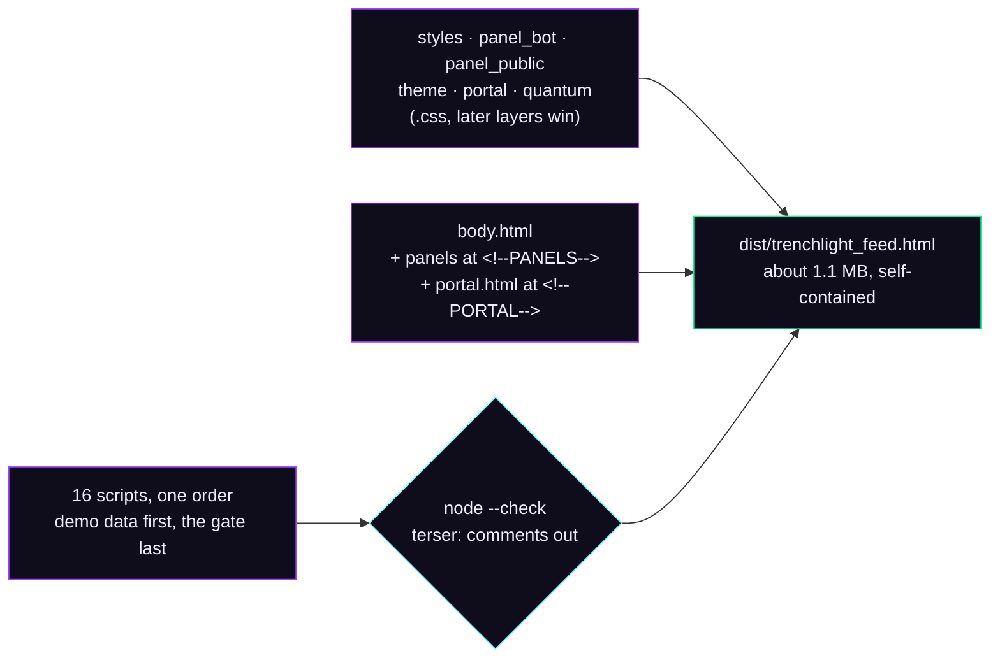
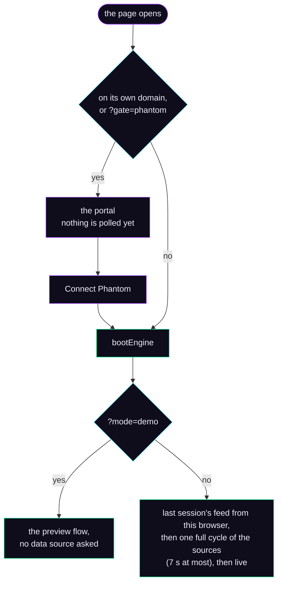
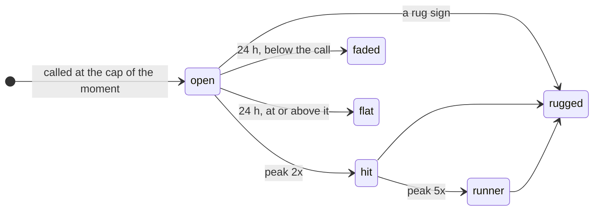
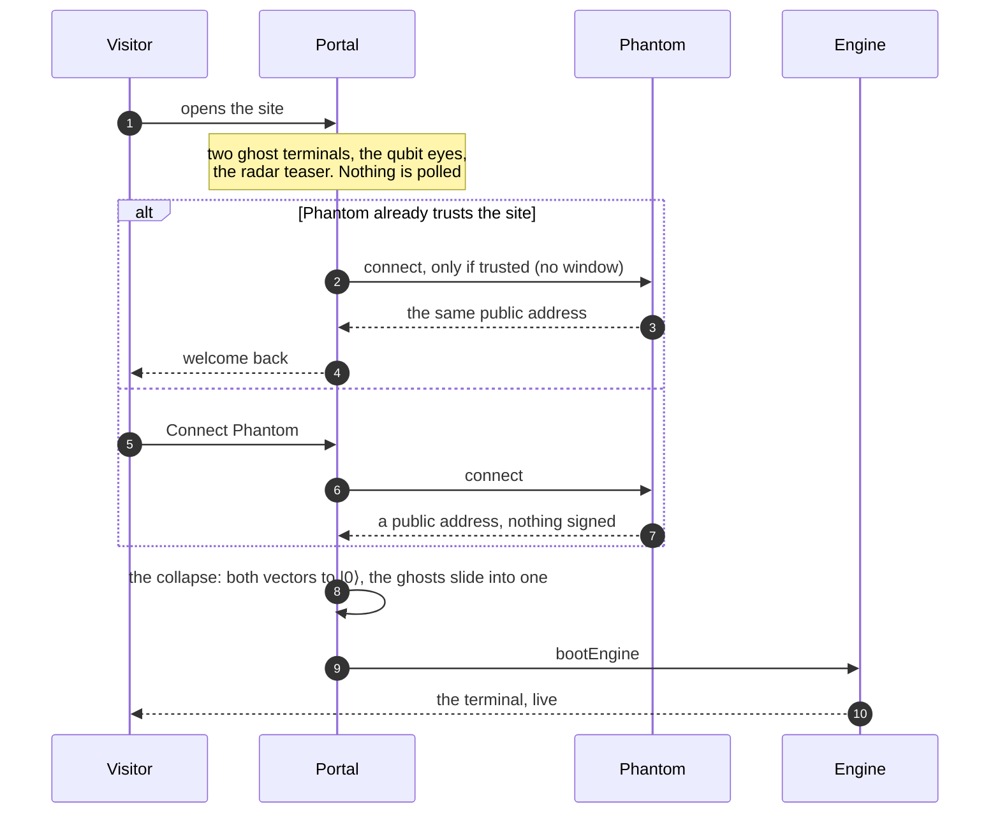
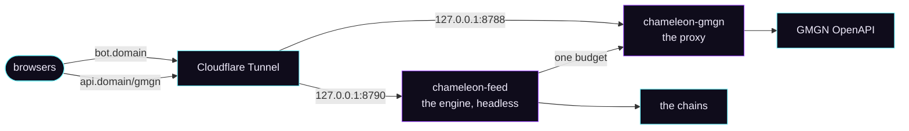

<div align="center">

# 🧬 Architecture

**How one HTML file reads two chains, judges every launch and keeps a public record.**

[The build](#the-build) · [How the page starts](#how-the-page-starts) · [Sources](#where-the-data-comes-from) · [Pictures](#pictures-first) · [Scoring](#three-scores-and-a-verdict) · [The gate](#the-rug-gate) · [Calls](#calls) · [Smart Tracking](#smart-tracking) · [Quantum radar](#the-quantum-radar) · [Portal](#the-portal-and-the-gate) · [Server](#the-server-side) · [Performance](#performance-rules) · [Tests](#tests)

</div>

<br>

## The build

There is no bundler. `build.py` stitches `src/` into one page, in a fixed order, and refuses to ship a page that does not parse.



- **One stamp.** `window.TL_BUILD = { version, built }` goes in first; the **Data sources** panel shows it, so a new upload can be told from an old one at a glance.
- **No comments in the shipped page.** [terser](https://github.com/terser/terser) only drops comments and spacing: no renaming, no rewriting, the code runs as written. HTML and CSS comments are dropped too. Without terser installed the build keeps the comments and says so.
- **A second file**, `dist/trenchlight_feed.artifact.html`, is the same page without the document shell, for hosts that embed a body.
- **Fonts** come from Google Fonts: Unbounded for the display, Bricolage Grotesque, IBM Plex Sans and Mono for the rest. Everything else is inline: the favicon is an SVG data URL, the preview pictures are inline WebP.

Every module adds itself to one global, `window.TL`:

| File | Global | What it does |
| --- | --- | --- |
| `app_core.js` | `TL.CONFIG` `TL.util` `TL.store` `TL.pics` | Config, helpers, the token model, scoring, the gate, the picture loader, the store |
| `app_sources.js` | `TL.sources` | Live data from the chains: the stream, the curves, Jupiter, Robinhood Chain, Blockscout |
| `app_gmgn.js` | `TL.gmgn` | The GMGN OpenAPI client: a key in this browser, or the site's proxy |
| `app_calls.js` | `TL.calls` | The calls: the rule, the journal, following each call to its end |
| `app_quantum.js` | `TL.quantum` | The quantum narrative: the words, the heat, the index, the portal's teaser |
| `app_smart.js` | `TL.smart` | Smart Tracking: the ranking, wallet profiles, the traders of a token |
| `app_xray.js` | `TL.xray` | A token's wallets read from its own transactions |
| `app_known.js` | `TL.known` | Known traders: the registry and their buys |
| `app_ui.js` | `TL.ui` | The interface: feeds, token pages, tabs, alerts, routing |
| `app_account.js` | `TL.account` | Who is looking: a Phantom address, nothing more |
| `app_portal.js` | `TL.portal` | The portal: the qubit eyes, the ring, the collapse |
| `app_gate.js` | `TL.gate` | When the portal shows and when the way opens |
| `app_bottab.js` | `TL.bottab` | The Trading bot guide tab |
| `demo_*.js` | `TL.demoFlow` | The preview: a snapshot of real launches and a moving flow of invented ones, all marked demo |

The server runs the same files: [`server/feed/engine.js`](../server/feed/engine.js) loads `app_core`, `app_calls`, `app_sources`, `app_gmgn`, `app_xray`, `app_smart` and `app_known` into Node 22 behind a few browser shims (`localStorage` written to disk, a `document` that draws nothing). Nothing is re-implemented, so a call on the server is exactly a call on the page.

<br>

## How the page starts



Off its own domain the page reads a few switches from the address. On the domain only `mode`, `gate` and `setup` are read, so a crafted link cannot point a visitor's page at somebody else's data:

| Parameter | What it does | On the site |
| --- | --- | --- |
| `?mode=demo` | The preview flow, no data source asked | ✓ |
| `?gate=phantom` | The portal and the Phantom gate | always on |
| `?setup=1` | Shows the setup cards (GMGN source, own nodes) | ✓ |
| `?api=http://localhost:8787` | Every source from the stand-in servers in `mock/` | ignored |
| `?calls=` `?board=` `?known=` | Another call journal, ranking or registry | ignored |
| `?gmgn=` | Another GMGN proxy | ignored |
| `?rpc=` `?hoodrpc=` | Your own Solana or Robinhood Chain node | ignored |
| `?terminal=` | Another address for the partner's BTC terminal | ignored |

Opened as a local file, the page runs live from public APIs. Inside a sandbox that cannot reach the chains it falls back to the preview by itself.

<br>

## Where the data comes from

| | Solana | Robinhood Chain |
| --- | --- | --- |
| **New launches** | The PumpPortal WebSocket: every pump.fun launch and migration the second it happens | Pons V2 factory events, read from the chain every 5 s |
| **Prices and caps** | pump.fun bonding curves read on-chain, every 5 s for what is on screen; Jupiter after graduation | Curve balances and trades; Uniswap v4 pool initialisation and swaps after graduation |
| **Holders and risks** | Jupiter: snapshot, holders, top holders, audit flags, dev history | Blockscout: holders and the ETH price |
| **Search** | Jupiter token search (the Quantum radar) | |
| **Optional** | GMGN OpenAPI: trenches, rankings, token security, top holders and traders, 1-minute candles, smart money and KOL feeds, wallet records | GMGN lists Robinhood Chain too |

Robinhood Chain has three public nodes with different strengths: the official node reads logs over any range but limits by address, PublicNode answers calls fast but keeps only about 90 blocks of logs, dRPC takes wide log ranges in small batches. Every call goes to the node that suits it, and a node that refuses rests while the next one takes over. Your own node, when given, goes first for every role.

**One cap, from the price.** A launchpad memecoin has a fixed supply of one billion and no vesting, so its cap is `price × 1,000,000,000`. Index APIs report a circulating cap instead, which comes out about a hundred times too small while the token is on its curve; the page always rebuilds the cap from the price.

**Trusted launchpads.** The feeds show pump.fun and PumpSwap on Solana, Pons and its Uniswap v4 pools on Robinhood Chain, nothing else. Top is about the coin, so established memecoins keep their place there, and the Quantum radar takes any Solana launchpad, because a narrative does not launch in one place.

<br>

## Pictures first

A row in the feed, a call, a runner or a card in Top appears **with its picture already loaded, or not at all**.

`TL.pics` loads the pictures a list wants in the background, before the row exists. Each token races its candidate addresses two by two: its IPFS file through pump.fun's Pinata gateway and Filebase first, then an image proxy, 4everland, ipfs.io and dweb.link, then the DEX Screener picture. When a token's metadata has to be read first, six gateways are asked in waves (the two fastest at once, the next two after 1.2 s, the rest after 2.5 s) and the first answer wins, because gateways differ by country and one slow gateway must never cost a picture. A token whose every candidate failed tries again after 8 s, 20 s, 45 s, 1.5 min, 3 min, then every 5 min.

A token opened on purpose (its page, the chart, a search result) is drawn at once, with a soft shimmer where the picture lands.

<br>

## Three scores and a verdict

Every token gets three scores from 0 to 100, each a sum of named rules, and every rule that fired is listed with its reason on the token page:

- **Safety**: dev share and dev history, serial deployers and launch farms, copies, bundles, snipers, insiders, the top ten, liquidity, authorities.
- **Momentum**: the buy rate against the previous hour, the share of buys, holder growth, the five-minute move, volume against cap, the curve's fill.
- **Community**: socials and the age of the X account, launchpad replies, holders, followers, a community takeover, smart wallets and KOLs inside.

| Verdict | When |
| --- | --- |
| **RUGGED** | Already gone: the cap fell off its own peak or the pool was emptied, in numbers this browser watched itself |
| **AVOID** | Safety under 35, a serial deployer, a Jupiter flag, a honeypot, a dead token, or any single rug sign |
| **CAUTION** | Safety under 60 |
| **STRONG** | Safety 70+, momentum 65+, and proven: at least 5 minutes old, 20 holders and 20 trades in the hour |
| **WATCH** | Everything else |

STRONG is earned and never given to a token seconds old. One rug sign outweighs any sum of points, so the verdict and the gate always agree.

<br>

## The rug gate

One function, `TL.hideReason`, decides whether a token shows. Every feed, count, suggestion and live insert asks it, so a token cannot be hidden on one path and shown on another. It hides any rug sign, a rugged token, an AVOID verdict, a stale or dead token, and a launch nobody bought. **Strict quality** adds CAUTION, no socials, fewer than 10 holders and any hard flag.

The thresholds are one set for the flags, the gate and the filters, calibrated on live launches:

| Rug sign | Hides at |
| --- | --- |
| Dev holds, on the curve | 10% |
| Dev holds, after graduation | 5% |
| Bundles | 30% |
| Snipers | 30% |
| Insiders | 30% |
| Top ten holders (with 20+ holders) | 50% |
| GMGN rug score | 30% |
| Launches by the same dev within an hour | 3 |

Hard flags on top: flagged by Jupiter, honeypot, can mint more, can freeze wallets, upgradeable contract, wash trading, liquidity not locked, a dev who sold early, a serial deployer.

<br>

## Calls

A call is the terminal's own pick, written down at the cap it was made at and followed in public to its end. The rule lives in [`src/app_calls.js`](../src/app_calls.js) and is the same for the page and the server.

| | **bond** | **breakout** |
| --- | --- | --- |
| When | 4 to 30 minutes after graduation | 30 minutes to 6 hours after graduation |
| The launch | Graduated within 6 hours of its birth | |
| The price | At least 5% above the graduation cap, holding 65% of its peak since | A new high 30% above the high before it, at least 2x the graduation cap |
| The money | Solana $10K in the last 5 minutes and $40K since graduation (Robinhood Chain $2K and $6K) | Solana $80K in the last 15 minutes (Robinhood Chain $12K) |
| Never | A cap 25x over the graduation cap minutes later (a broken print, not a run); a peak 1.6x over the graduation cap while still on the curve (a blow-off) | |

Neither kind ever calls a launch whose curve was bought out within three minutes of its birth: that is usually its own dev, and it is dumped soon after. Both also clear checks stricter than the feed's: at least 4 minutes old, safety 50+, $8K traded in the last hour and at least a tenth of the cap, buyers at least 45% of the trades, the top ten under 35% of what circulates, dev under 8%, bundles and snipers under 25%, insiders under 20%, no serial deployer. One call per network every 6 minutes, four an hour, 48 a day, the strongest candidate first.

The rules come from measurement, not taste: on a day of pump.fun graduations (1-minute candles), two thirds of all graduations had their curve bought out within three minutes of birth and a third of those were dumped within hours; a bond call at these bars came on about half of the rest, and most of those doubled. [`backtest/analyze.js`](../backtest/analyze.js) is the script behind it.



Every multiple of the call cap from 2x to 100x (2, 3, 5, 10, 25, 50, 100) is a milestone with its own note. Wherever `SITE.domain` names a site with a data service, the page shows the server's journal, the same calls for every visitor, and makes none of its own; with `SITE.domain` empty, a copy of the page calls by itself.

<br>

## Smart Tracking

The wallets worth following, read from GMGN. Candidates come from GMGN's smart money and KOL trade feeds and from the top traders of the hottest tokens in the feed. Each one is read from its 30-day GMGN record and scored.

GMGN publishes a track-record formula for its wallet skill (stop-loss discipline 34%, profit share 28%, return on capital 16%, sample 12%, win rate 10%). It measures only how a wallet's tokens ended, so a wallet that turned $40 into $70 four times scores like a desk running six figures. **Strength** keeps that shape and adds the two things that decide whether a record can actually be followed: the money a wallet puts to work, and how recent its record is.

| Part | Weight |
| --- | ---: |
| Realized profit | 22% |
| Return on capital | 18% |
| Consistency: win rate and how often a token doubled | 16% |
| Loss discipline: how rarely a token lost more than half | 14% |
| Position size: the average buy | 12% |
| Sample: how many tokens the record is built on | 10% |
| Still active | 8% |

Then the multipliers: a wallet that mostly trades its own launches counts at 45%, bot-speed trading at 85%, a sniper at 95%, a wallet funded under 5 days ago with big wins at 90%; GMGN smart money adds 5%, a verified known account 3%. To be called worth following over 30 days a wallet also needs 8+ tokens, 20+ trades, $5K put to work, $2.5K taken out, an average buy over $150, a 10% return, a 30% win rate, a trade in the last week and a strength of 55 or more. Grades: Elite 78+, Strong 62+, Decent 45+.

**Known traders** (`app_known.js`) are the KOLs and proven wallets GMGN knows by name. GMGN's KOL feed is read every 30 seconds, every wallet seen goes into one registry with its 30-day and 7-day records, and a buy becomes an alert only when you turn the cards on: a top-tier trader, $500 or more, a token the feed would show you.

**X-ray** (`app_xray.js`) needs no key: paste a token's contract and its wallets are read from the token's own transactions on Solana, or from Pons curve trades and Uniswap v4 swaps on Robinhood Chain, then ranked by what they made in that token.

<br>

## The Quantum radar

What the radar does is in the [README](../README.md#quantum-radar); how it does it is in [`src/app_quantum.js`](../src/app_quantum.js):

- `Q.match(t)` decides the narrative from the name and the ticker: the first of the words that matches labels the card. "Quant" is matched as a word of its own (`quant`, `quants`, `quantai`, `quantcat`, `quantdog` and a few more), so Quantico and quantity stay out.
- `Q.heat(t) = vol.h1 + 4 × vol.m5`, and `Q.list(chain)` is every eligible coin, hottest first.
- Eligible means: on the narrative, its risks already read, from a trusted launchpad or any Solana launchpad Jupiter knows, through the same gate as the feed, and something happening in it.
- `Q.scan(n)` searches Jupiter for `n` of the ten words in turn and refreshes the numbers of the coins already on the radar in the same round: six words in the first seconds, then two every three minutes.
- `Q.index(chain)` is the narrative's last hour above the cards: the money through it, its move weighted by volume, how many coins are moving, the leader.
- `Q.teaser()` is what the portal shows before anyone signs in: three Jupiter searches from the visitor's own browser, once per visit, a lighter screen than the full gate (a picture, money in the last hour, no loud rug sign in Jupiter's record), nothing stored. Its records join the store the moment the terminal opens, so the radar is full at once.

<br>

## The portal and the gate



- A returning visitor goes straight in only while Phantom itself still answers for the saved address. A session remembered in the browser is not enough on its own.
- About, Roadmap and Valley are open to everyone; the portal steps aside for them.
- There is no account server. The address is the identity in this browser, and the watchlist, the filters and the journal stay in `localStorage`.
- The eyes are SVG: a turret of scales around a Bloch sphere, with the state vector as the pupil. They precess on their own, jump the way a chameleon's eyes jump, and the cursor pulls them. Under *reduce motion* everything holds still.

<br>

## The server side



**The data service** ([`server/feed/feed.js`](../server/feed/feed.js)) publishes what every visitor shares:

| Route | What | Rebuilt at most every |
| --- | --- | --- |
| `GET /calls.json` | The call journal | 5 s |
| `GET /board.json` | The Smart Tracking ranking, built every 20 minutes | 30 s |
| `GET /known.json` | The registry of known traders and their buys of the day | 30 s |
| `GET /health` | How the service runs: from the server itself only, never through the tunnel | |

Each answer is built once and gzipped once, however many visitors ask. Reads of your own Solana node pass one gate, 4 a second by default, so the node keeps room for anything else. The engine's storage goes to disk at most every 15 seconds and when the process stops, so the journal survives a restart. An engine on a server never follows somebody else's journal: it makes its own calls.

**The GMGN proxy** ([`server/gmgn_proxy.py`](../server/gmgn_proxy.py)) is one Python file with no dependencies:

- the key stays on the server, and the proxy signs every request itself;
- only the read routes the page uses are forwarded, each with its own cache time (3 s for the trenches, 10 minutes for a wallet's 30-day record); trading routes are not proxied at all;
- one leaky bucket for the whole site, sized by the GMGN plan; a request that meets a full bucket waits a moment instead of failing;
- 90 requests a minute per visitor, by the address Cloudflare passes; the data service on the loopback is not limited;
- it answers browsers from one origin, `ALLOWED_ORIGIN`, by naming the origin that asked when it is on the list;
- it listens on `127.0.0.1` only.

**The headers** ([`cloudflare/_headers`](../cloudflare/_headers)): no framing by other sites (the Valley folder may be framed by the site itself), plugins off, no `<base>`, no content sniffing, a short referrer, no camera, microphone, location, payment or USB.

<br>

## Performance rules

Version 2.24 measured the terminal frame by frame. What it learned, as rules for anything new:

1. **No `backdrop-filter` over anything that moves.** A blurred backdrop is recomputed every frame the background changes. Glass is a translucent fill.
2. **Softness from gradients, not filters.** Big `blur()` layers, blend modes and animated `drop-shadow` are redrawn every frame. A soft light behind a shape looks the same and costs nothing.
3. **Animate `transform` and `opacity` only.** The compositor runs them alone: the logo's electron is two nested rotations, the live dots ping with scale and opacity, the shimmer slides.
4. **Draw nothing unseen.** While the portal covers the page, the terminal under it is `visibility: hidden` and its animations are paused. The portal's canvas draws at 30 frames a second at a pixel ratio of one.
5. **Respect reduce motion.** The decoration stops under `prefers-reduced-motion`; the numbers never move for it anyway.

`mock/test.py` checks the rules that can be checked (no big blurred or blended layers on the portal, the terminal not painted under it, no backdrop blur in the feed, no endless animation on the logo's drawing), and `mock/perf.py` loads the store with 1,500 tokens and a trade stream to time recompute and render.

<br>

## Tests

Nothing real is ever called. `mock/server.py` plays every source with the response shapes the real ones return: pump.fun, Jupiter, Solana's RPC (with its WebSocket), two Robinhood Chain nodes, Blockscout, DEX Screener, X's oEmbed and the token pictures; `mock/gmgn_mock.py` plays GMGN. It also takes orders from the tests: make a coin surge, refuse the next 30 requests with a 429, take a node down. Run it and open the page against it:

```bash
python3 mock/server.py 8787
open "dist/trenchlight_feed.html?api=http://localhost:8787"
```

The suites drive the page in headless Chromium with Playwright and check what a person would see. `bash test_all.sh` runs them all and writes each suite's output to `logs/`; see the [README](../README.md#-tests) for what each one proves.
